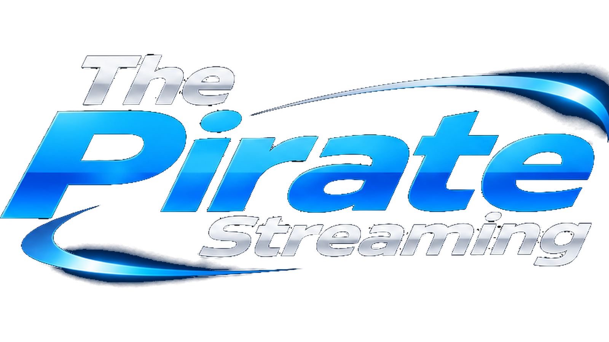
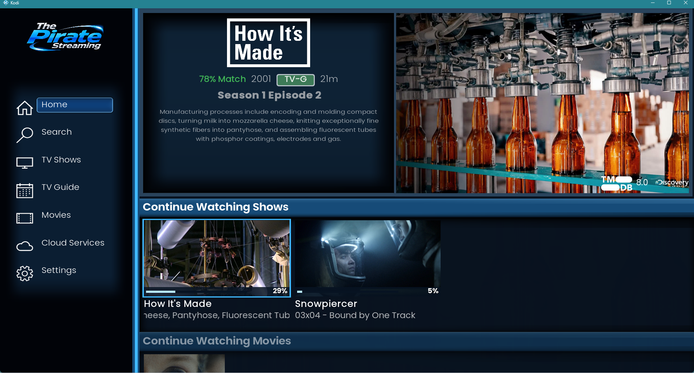
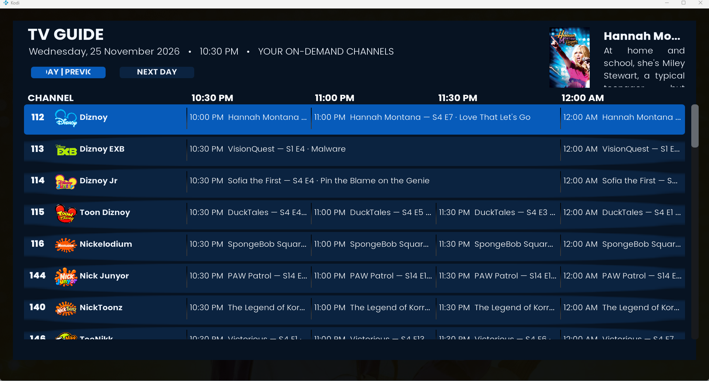
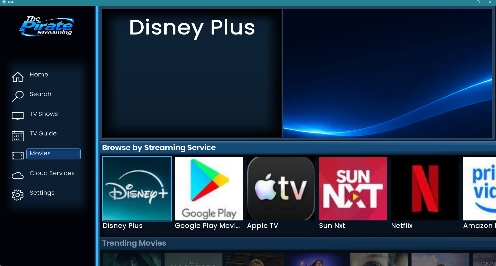
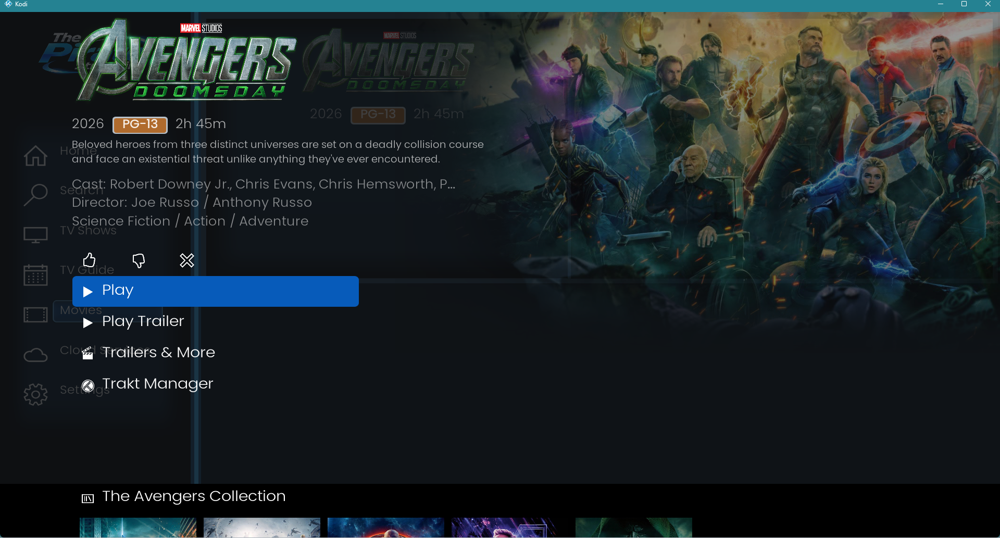
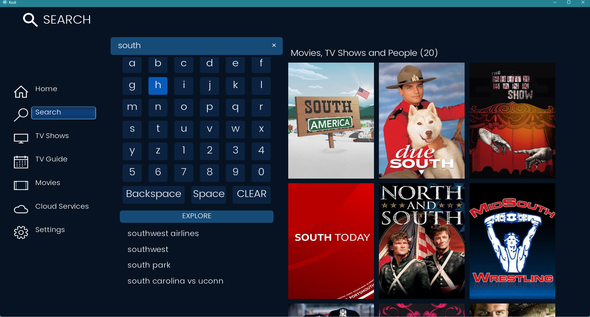
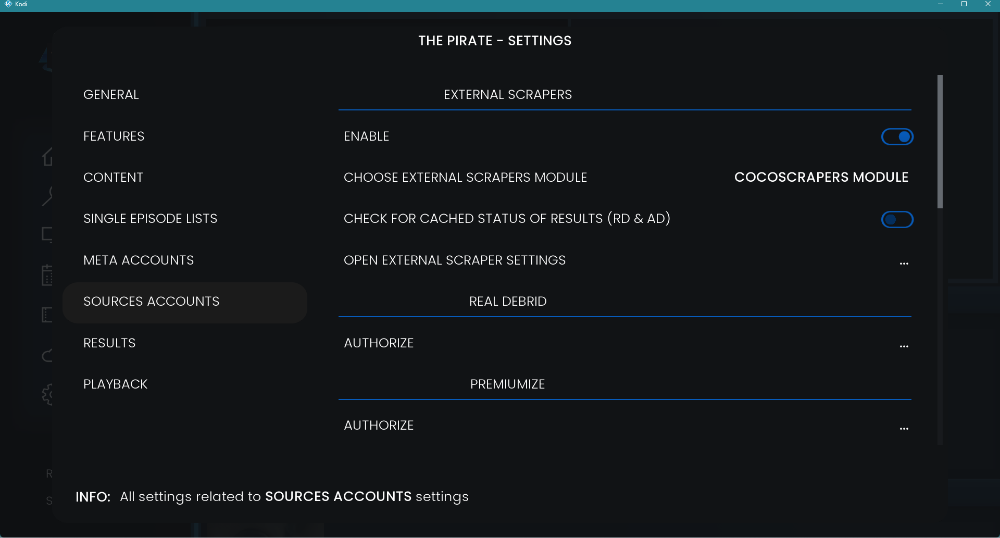

<p align="center">
  
</p>

# The Pirate Streaming

The Pirate is a Kodi video add-on based on FenLightAM, with a custom skin based on BINGIE Mod and an integrated TV Guide.

[Installation](#installation) · [Setup](#first-time-setup) · [Screenshots](#screenshots) · [Troubleshooting](#troubleshooting) · [Issues](#issues-and-feature-requests) · [Changelog](repo/plugin.video.pirate/resources/text/changelog.txt)

## Features

- Movie and TV show browsing and search
- TV Guide with scheduled, on-demand channels
- Trakt integration, Continue Watching and playback progress
- Debrid and external player support
- Custom skin designed for remote and controller navigation

The TV Guide simulates scheduled television using on-demand content. It does not carry live TV broadcasts. Playback availability depends on the configured providers.

## Screenshots



<details>
<summary>More screenshots</summary>

| TV Guide | Movies |
| --- | --- |
|  |  |
| **Information** | **Search** |
|  |  |
| **Settings** | |
|  | |

</details>

## Installation

Kodi with Python 3 add-on support is required. A remote, controller or keyboard is recommended. Mouse support is limited.

### Repository

1. In Kodi, go to **Settings > File manager > Add source**.
2. Select **None** and enter:

   ```text
   https://thepiratedylan.github.io/thepiratestreaming/
   ```

3. Name the source **The Pirate Streaming** and select **OK**.
4. Go to **Settings > System > Add-ons** and enable **Unknown sources**.
5. Open **Add-ons > Add-on browser > Install from zip file**.
6. Select **The Pirate Streaming** and install `repository.pirate-1.0.8.zip`.

Alternatively, [download the repository ZIP](repository.pirate-1.0.8.zip) and install it manually.

### Skin

1. Select **Install from repository > The Pirate Repo**.
2. Open **Look and feel > Skin > The Pirate Skin**.
3. Install the skin and its dependencies.
4. Select **Yes** when prompted to switch skins.

The required Pirate add-ons are installed alongside the skin.

## First-time setup

Open **Settings** from the home screen sidebar.

1. Authorize your playback provider.
2. Configure your scraper.
3. Authorize Trakt if you use it for lists or watch progress.
4. Test regular playback before opening the TV Guide.

Allow the guide to finish its initial preparation. Back up your skin configuration before changing menus, widgets or advanced settings.

## Updating

Updates are available through The Pirate Repo. When an update includes both the video add-on and skin, update both and restart Kodi.

Individual add-on ZIP files can also be installed manually. The GitHub source archive is not an installable Kodi add-on.

## Troubleshooting

- **Installation:** Check the repository URL. If the source is unavailable, try installing the repository ZIP manually. Include the name of any failed dependency in your report.
- **Skin:** Check that the video add-on and skin are up to date, then restart Kodi. The Pirate Skin can be selected under **Settings > Interface > Skin**.
- **Playback:** Check provider authorization, subscription status (where applicable) and scraper configuration. Note whether the problem affects one title or all playback.
- **Trakt:** Check account authorization and allow synchronization to finish. Note whether the issue affects the video add-on, home screen widgets or both.
- **TV Guide:** Allow guide preparation to finish and test regular playback. Include the affected channel, program and approximate time when reporting an issue.

## Issues and feature requests

- [Report a bug](https://github.com/ThePirateDylan/thepiratestreaming/issues/new?template=01_bug_report.yml)
- [Request a feature](https://github.com/ThePirateDylan/thepiratestreaming/issues/new?template=02_feature_request.yml)
- [View existing issues](https://github.com/ThePirateDylan/thepiratestreaming/issues)

Check existing issues before posting. Include your device, Kodi version, affected add-on version and steps to reproduce the problem.

Include a [Kodi debug log](https://kodi.wiki/view/Log_file) for crashes and playback errors where possible. Remove credentials, API keys, tokens and private playback links before posting logs.

Please report issues specific to The Pirate here, not in the upstream repositories.

## Changelog

[Video add-on changelog](repo/plugin.video.pirate/resources/text/changelog.txt)

## Credits

- **TikiPeter** — FenLight
- **AnonyMouse** — FenLightAM
- **BINGIE Mod team** — Skin base
- **kittmaster** — Kodi Texture Tool
- **Team Kodi** — Kodi and Android TV GUI sounds
- **Goldenfreddy0703 and drinfernoo** — Repository structure and examples
- **peno64** — Repository URL assistance

Thanks to the upstream developers and contributors whose work made this project possible.

The Pirate is independently maintained and is not affiliated with Team Kodi, the upstream projects or the third-party services shown in the interface.
